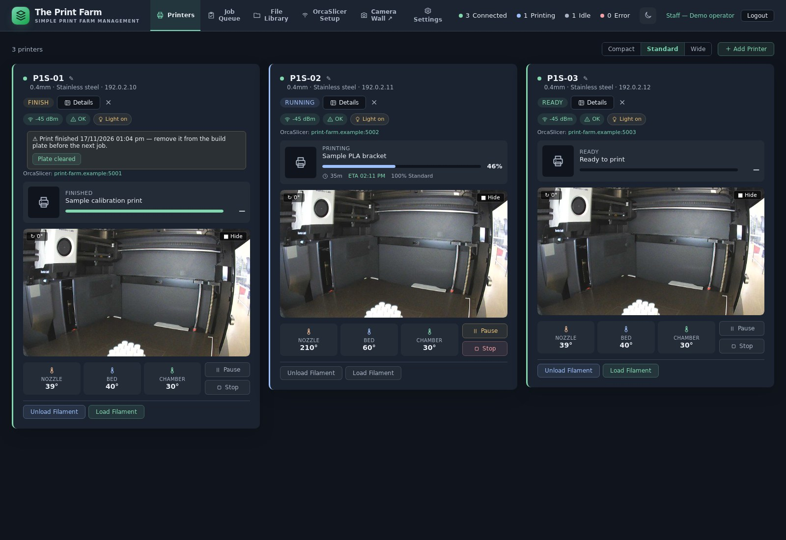
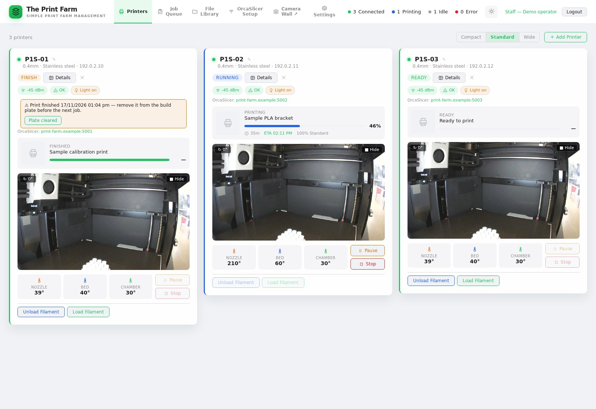
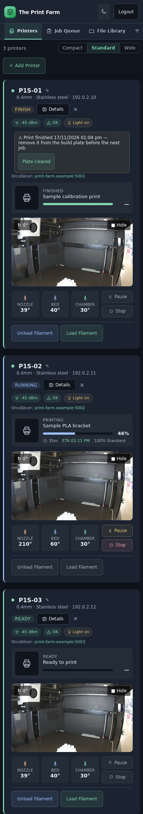
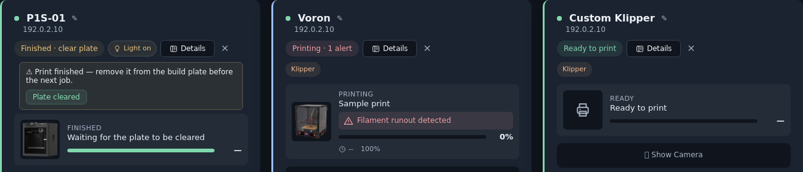
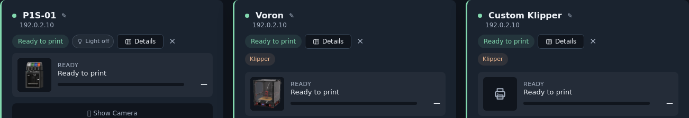
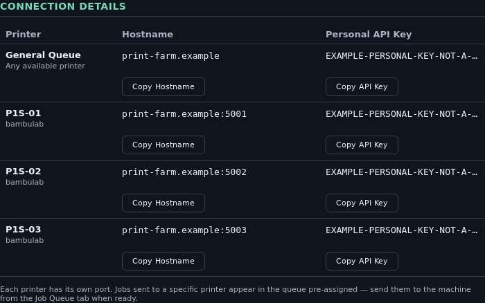

# Dashboard Screenshots

These screenshots show the current dashboard as of 17 November 2026. They were
captured in Chromium from the application’s rendered interface using sample
printer states, an example hostname, a demo account, and a dummy API key.
The same camera preview is reused across the example printer cards.

## Dark Theme

The dark theme uses brighter secondary text, layered slate backgrounds, and
soft mint, blue, amber, and rose status colours. Plate notices and action
buttons use subtle borders and fills; disabled controls keep readable labels.

## Light Theme

Use the moon/sun button in the header to switch themes. The choice is saved in
this browser; when no choice has been saved, the dashboard follows the device’s
preferred colour scheme. The light theme keeps its existing palette.

## Mobile Dashboard

Printer cards stack on narrow screens. The **Compact / Standard / Wide** control
changes card width on larger screens and remembers the choice in this browser.
Camera visibility and rotation are also saved per printer in the browser.

## Combined Status Button

The print state and health indicator now share one button, with actionable text
such as **Finished · clear plate**. Reported alerts appear alongside the state.
Click the button to open printer details; the separate **OK** chip is removed.
The light control shares the status row. Nozzle details, the Orca address, and
Wi-Fi strength are available in Details instead of appearing on each card.

## Idle Printer Pictures

Idle cards now show locally bundled printer pictures for recognised Bambu and
Voron models. Unknown Klipper models retain the generic icon. This view uses
sample printers; see [Printer Pictures](printers-and-orcaslicer.md#printer-pictures)
for model overrides and the supported models.

## OrcaSlicer Connection Details

**Copy Hostname** and **Copy API Key** sit beneath the values they copy. The
**Personal API Key** belongs to the signed-in user; copying includes the entire
key even when the table shortens its display. The credential pictured below is
a non-functional example.

Paste the hostname and personal key into Orca’s **Octo/Klipper** connection
settings. Uploads are recorded under the key owner’s username. On shared
computers, replace Orca’s saved key before another user submits a job. Existing
shared keys and Bambu LAN-mode connections do not identify individual users.
See [Printers and OrcaSlicer](printers-and-orcaslicer.md#copying-connection-details)
for the complete setup instructions.

## Updating the Screenshots

Capture the current application in a browser after allowing theme transitions
and camera images to finish loading. Use sample account and printer data, an
example hostname, and a clearly non-functional API key. Keep real credentials,
user names, job names, serial numbers, and internal network addresses out of
published screenshots. Use the same sample states for the dark and light views
so readers can compare them. These captures use a 1600-pixel desktop viewport
and a 390-pixel mobile viewport.
